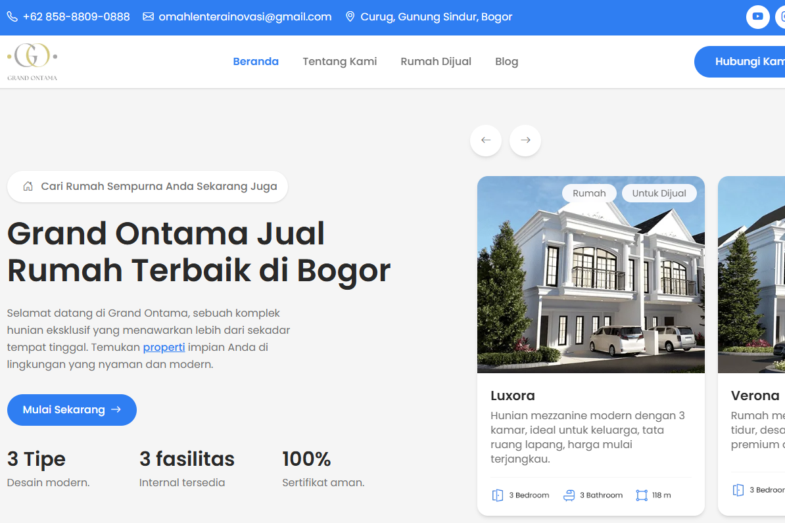

# Grand Ontama V1

Initial version of the Grand Ontama website featuring house type pages, a gallery, facilities, and property articles.

**Status:** Local development; a public demo is not yet available.

## Preview

## Features

- Luxora, Melodia, and Verona house type pages
- Interior gallery and facility information
- Property articles and a PHP contact form

## Technology

HTML, Tailwind CSS 4, JavaScript, PHP / PHPMailer.

## Running Locally

Use an Apache/PHP server, such as XAMPP. Place a copy of the project in the document root and open `beranda.html` through localhost. Any `.htaccess` rules require an appropriately configured Apache server.

Run `composer install` to install PHPMailer.

To build the stylesheet, run `npm ci` followed by `npm run build`.

## Project Versions

This version is retained as a local project. The live website uses the [Grand Ontama redesign](https://github.com/bagus-mahmudie/grand-ontama).

## Private Configuration

Copy the following templates to their corresponding local filenames, then enter the values for your environment:

| Template | Local File |
| --- | --- |
| `mailer/config.example.php` | `mailer/config.php` |

Local configuration files are ignored by Git. Do not include passwords, API keys, or account data in the source code.

## Repository Notes

Installed dependencies, caches, `.env` files, databases, and user uploads are not included. Brand names and third-party assets remain subject to their respective owners' rights. This repository does not grant a license for reuse.
